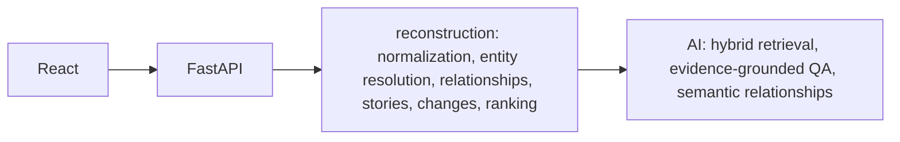

# ContextBridge

ContextBridge reconstructs what changed in a project while someone was away, and keeps every explanation tied to the records that produced it.

## The problem

Work context is fragmented across meetings, tickets, pull requests, documents, and discussions. After time away, the useful question is not “what was posted,” but what actually changed, why, and what still needs a decision.

## The solution

ContextBridge reconstructs that change over time. Raw events become a ranked catch-up, a context graph, a timeline, and search. An optional AI layer can explain the reconstruction. It does not replace it.

## Product demo

A live URL is not deployed yet. Run the app locally with the commands below. Project Atlas is synthetic data for Alex Morgan at Northstar Technologies, away September 16–23. Slack, Jira, and GitHub are not connected.

## Key experiences

- What Did I Miss: a guided catch-up of the Atlas absence, with evidence beside each change
- Context graph: requirements, decisions, tasks, code, and people in one view
- Trace Why and Trace Impact: follow the causal chain into and out of a decision
- Timeline: September 16–23 story lanes, not a Gantt chart
- Hybrid search: keyword match plus a local semantic score
- Ask Context: a question answered from retrieved project evidence

## Architecture



There is no database. The browser keeps theme, sidebar, workspace, and project selection. Graph layout stays in React Flow.

## Pipeline

Raw events → normalization → entities → relationships → stories → changes → ranking.

Relationships include `triggered`, `discussed_in`, `resulted_in`, `implemented_by`, `superseded_by`, `evidence_for`, `blocked_by`, and `assigned_to`. Ranking favors decision changes, requirement changes, blockers, direct user impact, mixed sources, and unresolved items. Noise is not cited.

The authentication chain that the engine reconstructs is: customer feedback → enterprise SSO requirement → architecture discussion → Auth0 selected → AUTH-142 → PR #184 → token-refresh limitation → authentication decision revised → custom authentication architecture. Auth0 stays superseded. The custom architecture stays current.

## AI layer

`AI_PROVIDER=none` still serves catch-up, the graph, the timeline, and search. Ask then says AI reasoning is unavailable. `mock` is deterministic and offline. `openai` and `gemini` run only on the server, and only when `AI_API_KEY` is set. A missing key falls back to none. Gemini text uses `gemini-3.8-flash` when `AI_MODEL` is empty. Embeddings stay on a local concept vector.

## Evidence and provenance

Deterministic edges are labeled `deterministic`. An inferred edge is dashed, labeled `ai_inferred`, and the detail panel says it is AI inferred. Ask and Why cite event ids that exist in the reconstruction. Unknown ids are dropped. If the records are not enough, Ask says ContextBridge doesn't have enough project evidence to answer this confidently.

## Frontend

React, TypeScript, and React Router. Feature folders cover catch-up, graph, timeline, search, and ask. `@xyflow/react` draws the graph. Layout is responsive. State is local React state plus the URL (`story`, `focus`, `q`, and filters). There is no Redux. `src/services/api/client.ts` is the only module that reads `VITE_API_BASE_URL`. The graph and timeline routes load with `React.lazy`.

If the first API check fails, or `VITE_API_BASE_URL` is empty, the app shows the local Atlas demo and the label “Demo workspace — synthetic Project Atlas data”. If a configured API was already connected and a later request fails, the screen stays on “Reconstruction unavailable” with “Use demo data”.

## Backend

FastAPI and Pydantic. Services reconstruct the project and, when configured, call `AIProvider`. `GET /health` returns `{"status":"healthy","service":"contextbridge-api"}` and does not call a model. `GET /api/capabilities` reports whether a provider will actually run.

## Deployment

Neither Firebase Hosting nor Cloud Run is deployed. The repo only contains the config and the container.

Checklist, all manual and not done:

- [ ] Create a Firebase project and run `firebase use --add` from `.firebaserc.example`. Do not commit a real project id.
- [ ] `npm run build`, then `firebase deploy` for Hosting only. `firebase.json` rewrites every route to `/index.html`.
- [ ] Enable billing, the Cloud Run API, and `gcloud` auth in a Google account.
- [ ] `gcloud run deploy` the `backend` image, set `PORT`, and pass `ENVIRONMENT`, `ALLOWED_ORIGINS`, and `AI_PROVIDER` at runtime. Do not bake `AI_API_KEY` into the image.

A Content-Security-Policy header is omitted because the API origin is chosen at build time through `VITE_API_BASE_URL` and cannot be named in `firebase.json`. Hosting does send `X-Content-Type-Options: nosniff`, `Referrer-Policy: strict-origin-when-cross-origin`, and a Permissions-Policy that disables camera, microphone, and geolocation.

## Local commands

Frontend:

```bash
npm install
npm run dev -- --host 0.0.0.0 --port 43123
```

Open [http://127.0.0.1:43123](http://127.0.0.1:43123). `/` redirects to `/overview`.

Backend:

```bash
cd backend
python3 -m venv .venv
.venv/bin/pip install -r requirements.txt
.venv/bin/uvicorn app.main:app --host 0.0.0.0 --port 8077
```

Tests and production bundle:

```bash
cd backend && .venv/bin/pytest
npm run build
npm run lint
```

API image:

```bash
docker build -t contextbridge-api -f backend/Dockerfile backend
docker run --rm -e AI_PROVIDER=none -e PORT=8080 -p 18080:8080 contextbridge-api
curl http://127.0.0.1:18080/health
```

`docker compose up` is local-only and maps `8077:8080`. Do not start it while uvicorn already owns 8077.

Environment names are in `.env.example`: `VITE_API_BASE_URL`, `ENVIRONMENT`, `ALLOWED_ORIGINS`, `AI_PROVIDER`, `AI_API_KEY`, `AI_MODEL`, and `PORT`. Do not commit `.env`, keys, or service accounts.

## Synthetic Atlas data

The people, tickets, and pull requests are written for this demo. The sidebar says so. The reconstruction still runs on those raw events, so the graph, timeline, and catch-up agree on the same story.

## Screenshots

Reproduce these with the frontend on port 43123 and the API on port 8077 (`AI_PROVIDER=mock` for Ask):

- `/overview` — light, desktop
- `/catch-up?story=authentication-architecture` — the authentication story, light
- `/graph?focus=authentication-decision-revised` — open the revised decision and choose Trace Why
- `/timeline` — September 16–23, light
- `/ask` — ask “Why did we stop using Auth0?”

## Known limitations

The rate limit is in memory on one process. Semantic search uses a local concept vector, not a hosted embedding model. Decisions and sources are previews, not live catalogs. There is no authentication. This repository does not deploy, create a Firebase project, or enable billing.

## Routes

| Path | Page |
| --- | --- |
| `/overview` | Overview dashboard |
| `/catch-up` | What you missed |
| `/timeline` | Timeline |
| `/graph` | Context Graph |
| `/decisions` | Decisions preview |
| `/sources` | Sources preview |
| `/search` | Project search |
| `/ask` | Ask Context |
| `/settings` | Settings, including theme |
| `/help` | Help |
