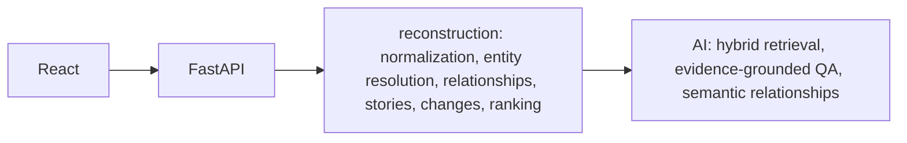

# ContextBridge

ContextBridge reconstructs scattered workplace context for Northstar Technologies. Alex Morgan, Senior Product Engineer, was away September 16–23 (8 working days). The product shows what changed on Project Atlas: the Auth0 decision, the September 22 revision, and the payment sandbox blocker.

The reconstruction is deterministic. An optional AI layer can explain those results. It does not replace them. `AI_PROVIDER=none` still serves catch-up, the graph, the timeline, and search.

## Architecture



Raw Atlas events stay in the backend. The API returns project records. React Flow layout stays in the browser. There is no database.

## Features

- Overview for the September 16–23 absence
- Guided catch-up with evidence and an explicit demo fallback
- Context Graph with Trace Why and Trace Impact
- Timeline story lanes and project search
- Ask Context, evidence-checked explanations, and hybrid search when a provider is on
- Dashed AI-inferred graph edges that do not overwrite deterministic edges

## React structure

Pages live under `src/pages`. Feature UI lives under `src/components` (catch-up, graph, timeline, search, ask). `src/services/api/client.ts` is the only module that reads `VITE_API_BASE_URL`. Hooks load catch-up, graph, timeline, search, explanations, and capabilities. Theme, sidebar, workspace, and project selection stay in the browser.

## Reconstruction pipeline

Raw events are normalized, then resolved into entities and relationships (`triggered`, `discussed_in`, `resulted_in`, `implemented_by`, `superseded_by`, `evidence_for`, `blocked_by`, `assigned_to`). Those become stories, meaningful changes, and a ranked catch-up. Ranking favors decision changes, requirement changes, blockers, direct user impact, mixed sources, and unresolved items. Noise is not cited.

## AI architecture

`AIProvider` is server-only: `none`, `mock`, `openai`, and `gemini`. `get_provider()` returns nothing for `none`, and for `openai` or `gemini` when `AI_API_KEY` is missing. The React app never sees a key. Ask retrieves at most 8 events. Outputs are checked against known event ids and clipped. Hybrid search weights keyword, semantic similarity, importance, and recency. Gemini text uses `generateContent`. Gemini embeddings stay on the local concept vector.

## Provenance

Deterministic edges are `confidenceSource: deterministic`. An inferred edge is `ai_inferred` and drawn dashed. Explanations and Ask answers cite evidence from the reconstruction. When the provider is off or fails, Why falls back to that evidence: “AI explanation is temporarily unavailable. Showing the reconstructed project evidence instead.”

## Graph

The Context Graph is a React Flow view of the API graph. Focus, Trace Why, and Trace Impact stay client-side. Auth0 superseded by the custom architecture is not a causal column. The React Flow attribution stays visible.

## Timeline

`/timeline` is story lanes for September 16–23, not a card list or a Gantt chart. Explore Context opens `/graph?focus=`. Graph detail can return to `/timeline?focus=`.

## Hybrid search

`/search` queries the API. `mode=keyword` is the deterministic match. `mode=hybrid` adds the local semantic score. The top bar submits to `/search?q=`.

## Ask Context

`/ask` sends the question to the API. Suggested questions cover the authentication change, blockers, attention, and decisions. When `GET /api/capabilities` reports `ai: false`, the page says AI reasoning is unavailable and leaves catch-up, the graph, the timeline, and search in place.

## Stack

React, TypeScript, Vite, Tailwind, React Router, Lucide, shadcn primitives (Button, DropdownMenu, Dialog, Tooltip, Sheet, Popover; radix-ui and class-variance-authority), `@xyflow/react`, FastAPI, Pydantic, Docker, Firebase Hosting config, Cloud Run readiness, a Gemini provider, and GitHub Actions.

## Local development

Frontend:

```bash
npm install
npm run dev -- --host 0.0.0.0 --port 43123
```

Open [http://127.0.0.1:43123](http://127.0.0.1:43123). `/` redirects to `/overview`.

Backend:

```bash
cd backend
python3 -m venv .venv
.venv/bin/pip install -r requirements.txt
.venv/bin/uvicorn app.main:app --host 0.0.0.0 --port 8077
```

Production frontend bundle:

```bash
npm run build
```

API image (no secrets, no `.env`):

```bash
docker build -t contextbridge-api -f backend/Dockerfile backend
docker run --rm -e AI_PROVIDER=none -e PORT=8080 -p 18080:8080 contextbridge-api
curl http://127.0.0.1:18080/health
```

`docker compose up` is local-only and maps `8077:8080`. Do not start it while uvicorn already owns 8077.

## Environment variables

See `.env.example`. Do not commit `.env`, keys, or service accounts.

| Name | Role |
| --- | --- |
| `VITE_API_BASE_URL` | API origin baked in at frontend build time. Default `http://127.0.0.1:8077`. |
| `ENVIRONMENT` | `production` switches CORS to `ALLOWED_ORIGINS` only. Unset keeps the Vite dev origins. |
| `ALLOWED_ORIGINS` | Comma-separated browser origins. |
| `AI_PROVIDER` | `none`, `mock`, `openai`, or `gemini`. |
| `AI_API_KEY` | Server only. Never in the image, the bundle, or React. |
| `AI_MODEL` | Optional. Empty uses `gpt-4o-mini` for OpenAI and `gemini-3.8-flash` for Gemini. |
| `PORT` | Container listen port. Default 8080. |

## Tests

```bash
cd backend
.venv/bin/pytest
```

Tests use `mock` or `none`. They do not call Gemini or OpenAI.

## Docker

`backend/Dockerfile` is a production image: Python 3.12, non-root user, `uvicorn` without `--reload`, listen on `$PORT`. `GET /health` returns `{"status":"healthy","service":"contextbridge-api"}` and does not call a provider. `GET /api/health` remains `{"status":"ok"}`.

## Deploy architecture

What is in the repo:

- `firebase.json` serves the Vite `dist` directory as a single-page app. `**` rewrites to `/index.html`, so `/overview`, `/catch-up`, `/timeline`, `/graph`, `/search`, and `/ask` survive refresh. Hashed `/assets/**` are cached for a year. `index.html` is `no-cache`.
- `.firebaserc.example` is a placeholder. Run `firebase use --add` in a Google account you control. Do not commit a real project id.
- The API container is ready for Cloud Run: it listens on `$PORT` and reads configuration from the environment.

What you do in a Google account (not run here):

```bash
gcloud run deploy contextbridge-api \
  --source backend \
  --set-env-vars ENVIRONMENT=production,AI_PROVIDER=none,ALLOWED_ORIGINS=https://YOUR_HOSTING_ORIGIN \
  --port 8080
```

Pass `AI_API_KEY` as a runtime environment variable or secret if you choose a live provider. Do not bake it into the image. Cloud Run sets `PORT`. Billing, API enablement, and `gcloud` auth are manual and were not run.

A Content-Security-Policy header is omitted because the API origin is chosen at build time through `VITE_API_BASE_URL` and cannot be named in `firebase.json`.

## Security

Hosting sends `X-Content-Type-Options: nosniff`, `Referrer-Policy: strict-origin-when-cross-origin`, and a Permissions-Policy that disables camera, microphone, and geolocation. Production CORS never allows `*`. Ask, explain-change, and story summary are limited to 20 requests per IP per 60 seconds and to 500 characters per question. Provider calls time out at 20 seconds. Error responses omit stack traces, keys, and filesystem paths. Logs record path, status, latency, provider name, and fallback. They do not record keys or full prompts.

## Limitations

The rate limit is in memory on one process. Semantic search uses a local concept vector, not a hosted embedding index. Gemini text generation is implemented and uncalled unless `AI_PROVIDER=gemini` and a key are set. This repository does not deploy, create a Firebase project, or enable billing.

## Routes

| Path | Page |
| --- | --- |
| `/overview` | Overview dashboard |
| `/catch-up` | What you missed |
| `/timeline` | Timeline |
| `/graph` | Context Graph |
| `/decisions` | Decisions preview |
| `/sources` | Sources preview |
| `/search` | Project search |
| `/ask` | Ask Context |
| `/settings` | Settings, including theme |
| `/help` | Help |
